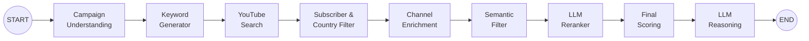
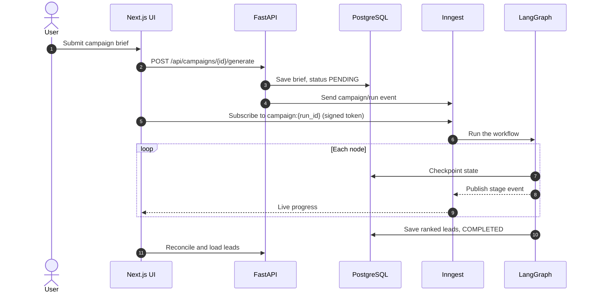

<div align="center">
  <br>
  <h1>Reach AI</h1>
  <p><strong>Creator marketing that startup and solo founders can actually run</strong></p>
  <p>Find the creators who will convert for your product, see what each one should cost, reach them, and track what they deliver, all in one app.</p>
  <br>
  <a href="#-why-reach-ai">Why</a> ✦
  <a href="#-what-it-does-today">What it does</a> ✦
  <a href="#-how-we-improved-it">How we improved it</a> ✦
  <a href="#-where-its-going">Where it's going</a> ✦
  <a href="#-why-jev">Why Jev</a> ✦
  <a href="#-architecture">Architecture</a> ✦
  <a href="#-getting-started">Getting started</a>
  <br>
</div>

<hr>

## ◈ Why Reach AI

I built Reach AI after seeing how hard creator discovery was while building **Haven**, a college dating app. Our first organic campaign reached 17k+ views in a week, but finding the right creators still meant hours of manual scrolling and guesswork, with no idea what a fair price was.

Founders have the same problem everywhere:
- **No marketing team, small budgets.** Solo founders spend roughly $60–180 a month on all their software, and one sponsored post costs $200–2,000.
- **Existing tools aren't built for them.** Database tools (Modash, Upfluence) cost $199–600 a month, often on annual contracts, and still leave the founder doing the work.
- **The two biggest fears are wasted time and overpaying.** Founders don't know which creators will convert, or what a creator should cost.

**Positioning:** *the creators who will actually convert for you, and what you should pay them.* We compete on match quality and fair pricing, not on being the cheapest.

<br>

## ◈ What it does today

| Feature | Status |
|---|---|
| **Campaign-aware YouTube discovery**: reads the brief (product, price point, persona, goal) and generates strategic search queries, not just hashtags | ✅ Live |
| **Brand-fit ranking** with a written reason for each creator | ✅ Live |
| **Performance and fair price**: median views, reliability, engagement, estimated CPM, valuation and expected clicks per video | ✅ Live |
| **Risk filters**: inactive channels, suspicious engagement, geo mismatch, view floors | ✅ Live |
| **Personalised pitches** per creator (email, Instagram, X, LinkedIn), with rule validation and one automatic repair | ✅ Live |
| **Durable background runs** (Inngest + Postgres checkpoints) with live progress in the UI | ✅ Live |
| Export to Instantly / Smartlead | ✅ Live |
| User docs and changelog at `/docs` | ✅ Live |
| Foundations for the next version: LLM routing with fallbacks, Jev client, cost logging, shared cache | ✅ Built, not wired in yet |
| X, Instagram, LinkedIn · in-app sending and follow-ups · post tracking · billing | 🛠 Planned (see [roadmap](docs/ROADMAP.md)) |

<br>

## ◈ How we improved it

### v1 → v2: from $5 to $0.04 per run
The first working version cost about **$5 per run** and took **4+ minutes**. Tracing every step in LangSmith showed where the time and money went, so I:
- moved expensive work to **concurrent, batched** processing (enrichment 20 channels at a time, LLM reranking in batches of 15);
- put **cheap filters first** (subscriber, country, activity and engagement checks in code) so the LLM only sees a shortlist;
- added a **hybrid semantic filter** (embeddings + BM25) that keeps the top 30 before any LLM call;
- **cached** repeated work and removed unnecessary sequential model calls;
- wrote the "why this creator" reasoning **only for the creators the user actually gets**.

| Metric | v1 | v2 |
|---|---|---|
| AI cost per run | ~$5 | **~$0.04** (−99%) |
| Run time | 4+ min | **1–2 min** (−60%+) |
| Quality | — | Beat Aha (market leader) and v1 on the same brief, then held up across other briefs, including edtech |

### Outreach: tested, not guessed
Pitch generation runs one branch per creator. A **rule validator** catches AI clichés, leaked internal scores, wrong channels and too many questions, and repairs a pitch at most once. A **LangSmith eval suite** (28 cases from real leads) scores groundedness, personalisation, tone and CTA quality, so prompt changes are measured before they ship. See [`backend/OUTREACH_EVALUATION.md`](backend/OUTREACH_EVALUATION.md).

<br>

## ◈ Where it's going

The next version keeps the same rule that made v2 cheap (**cheap work first, expensive work last**) and applies it across the whole funnel. Full design: [`docs/TECHNICAL_SPEC.md`](docs/TECHNICAL_SPEC.md). Status of every feature: [`docs/ROADMAP.md`](docs/ROADMAP.md).

**1. Who does what.** Every step goes to the cheapest thing that can do it well:

```
Code / APIs  →  Statistics / ML  →  Jev (judgments)  →  Code (scoring)  →  LLM (writing)
   free             ~free              ~$0.01/run            free            top picks only
```

- **Numbers stay in code**: median views, growth momentum, engagement compared with creators of the same size, fake-engagement detection (Isolation Forest), fair price.
- **Judgments go to Jev**: is this a real person, does the content fit the product, is the audience right, is it brand-safe, is it for kids.
- **LLMs only write** what people read: the campaign strategy, the "why this creator" brief, pitches and replies.

**2. More platforms, chosen by founder type.**
- B2B and AI founders get **YouTube, X and LinkedIn**.
- Consumer-app founders get **Instagram and YouTube**.
- A quick Jev check adjusts this for each product, and the founder can switch any platform on or off.

**3. Cheapest sources first, without missing the best creators.**
- Each run checks, in order: our own creator database, YouTube, then the other accounts creators link from their own profiles.
- A **small test search on every selected platform** follows. If any creator from it would make the current top list, that platform gets a full search.
- A benchmark against full searches must find at least 90% of the same top 10.

**4. Outreach that founders can trust.** A founder contacts about 15–40 creators, so every message matters:
- the creator's own business email, verified, with sponsor and guest addresses filtered out;
- one research profile per creator, reused by every message;
- every claim in a pitch checked against the creator's real content;
- sent from the founder's own inbox, after approval;
- follow-ups that stop the moment the creator replies on any platform.

**5. After the deal.**
- A creator page to sign and submit drafts.
- Automatic checks that the post went live, with the link, promo code and #ad disclosure.
- Views, clicks and signups compared with our forecast.
- A pay-now request once the post is verified.
- A budget planner that picks the creators with the most expected clicks per dollar.

**6. Pricing.** A small monthly plan with credits that carry over (Starter $49, Growth $129, Agency $349). Payments go through Cashfree. Costlier platforms use more credits, and writing pitches is free.

<br>

## ◈ Why Jev

Most of the AI work in an influencer pipeline isn't writing. It's **judging**: *is this a real creator? does this audience match the persona? is this post sponsored? is this reply interested or declining?* Using an LLM for these is slow, expensive and hard to calibrate, because LLMs tend to hand out the same few scores (70, 85…) and their numbers aren't real probabilities.

[**Jev**](https://docs.typesafe.ai/introduction) by TypeSafe AI is a *System One* model built for exactly this. You send it some state and typed questions, and it returns typed answers with probabilities:

| Question type | Returns | Example in Reach AI |
|---|---|---|
| **Noul** (yes/no) | P(yes) | "Is this account a single person, not a brand or reupload page?" |
| **Choice** (one of a list) | option + confidence | "Main niche?", "Is this reply interested, asking for rates, or declining?" |
| **Score** (scale of situations) | level 0…n, can be fractional | "How closely do the recent posts match the product?" |

**Why it fits:**
- **Cost:** about **$0.042 per million input tokens**, and output is free. Judging 100 creators with ~10 questions each costs about **$0.006**.
- **Speed:** about 100 ms per request, and all of an item's questions run in parallel inside one request.
- **Calibrated numbers:** thresholds like "drop if P(individual) < 0.4" mean something, and the numbers can become features for a learned ranker later.
- **It doesn't write text**, so it can't invent claims. Writing stays with the LLM, on the shortlist only.

**Where Jev is used in the plan:**
- creator fit, audience, safety, kids content, language and niche;
- picking a platform;
- choosing the creator's real email from several candidates;
- checking every claim in a pitch;
- sorting replies;
- confirming a post promotes the product and has a disclosure.

**How we use it safely:**
- The model is pinned (`jev-1.13.0`), with at most 8 requests at a time.
- Thresholds are tuned on about 300 labelled creators.
- If Jev is unavailable, the same questions go to an LLM fallback and come back in the same shape.
- A Jev answer alone can never trigger a send or a payment.

<br>

## ◈ Architecture

### Today's discovery pipeline (YouTube)
A LangGraph `StateGraph` with 9 nodes, retry policies and Postgres checkpointing, run in the background by Inngest:



### Run flow and live progress


### Next: durable steps per platform
To stay within Vercel's per-request time limits as platforms are added, each run becomes short **Inngest steps**: strategy, then one step per platform in parallel (each a LangGraph graph), then merge and rank, a probe check, briefs and finalise. A failed step retries alone. Shared limits (for example, at most 8 Jev requests across all runs) use Inngest concurrency keys. Caches live in Postgres so they survive across serverless calls. Details in spec §4.14.

<br>

## ◈ Tech stack

`Next.js` · `TypeScript` · `Python` · `FastAPI` · `LangGraph` · `Inngest` · `PostgreSQL` · `LangSmith` · `Jev (TypeSafe AI)` · `Gemini` / `gpt-oss-120b` (Groq, Cerebras) · `Clerk` · `Zustand` · `Vercel`

<br>

## ◈ Project structure

```text
ReachAi-InfluencerMarketing/
├── backend/
│   ├── app/
│   │   ├── api/routes/     Campaign, saved-lead and outreach routes
│   │   ├── my_agent/       Current YouTube discovery graph
│   │   ├── outreach/       Pitch generation graph (generate → validate → repair)
│   │   ├── workflow/       Graph runtime, checkpoints, live stage events
│   │   ├── inngest/        Background functions
│   │   ├── llm/            LLM routes with fallbacks (new)
│   │   ├── judge/          Jev client with LLM fallback (new)
│   │   ├── billing/        Cost logging (new)
│   │   ├── discovery/      Postgres cache (new; next-version pipeline goes here)
│   │   └── models/         SQLAlchemy models (migrations in alembic/)
│   └── tests/              Foundations tests + outreach evals
├── frontend/               Next.js app (campaign flow, results, outreach)
│   └── content/docs/       Public user docs (served at /docs)
├── docs/
│   ├── ROADMAP.md          What's built, what's next, where each spec is
│   └── TECHNICAL_SPEC.md   Full design and decisions
└── CLAUDE.md               Guide for coding agents working on this repo
```

<br>

## ◈ Getting started

**Prerequisites:** Python 3.11+, Node.js 20+, PostgreSQL, a Google Cloud project with YouTube Data API v3, and a Google AI Studio key.

```bash
# Backend
cd backend
python -m venv .venv && source .venv/bin/activate
pip install -r requirements.txt
cp .env.example .env            # then fill in the keys below
alembic upgrade head
uvicorn app.main:app --reload
```

```bash
# Inngest dev server (second terminal)
cd backend
npx inngest-cli@latest dev -u http://localhost:8000/api/inngest
```

```bash
# Frontend (third terminal)
cd frontend
npm install
npm run dev
```

```bash
# Tests (no live API calls)
cd backend
pip install -r requirements-dev.txt
pytest tests -q
```

### Environment variables (`backend/.env`)
| Variable | What it's for | Required |
|---|---|---|
| `DATABASE_URL` | PostgreSQL (`postgresql+asyncpg://…`) | ✅ |
| `GOOGLE_API_KEY` | Gemini models | ✅ |
| `YOUTUBE_API_KEY` | YouTube Data API v3 | ✅ |
| `INNGEST_DEV` | `1` for local development | Local |
| `INNGEST_EVENT_KEY`, `INNGEST_SIGNING_KEY` | Inngest Cloud | Production |
| `CLERK_JWKS_URL` | Clerk auth | Production |
| `GROQ_API_KEY`, `CEREBRAS_API_KEY` | gpt-oss-120b fallbacks | Optional |
| `TYPESAFE_API_KEY` | Jev | Optional (next version) |
| `LLM_BACKEND`, `LANGSMITH_GATEWAY_URL` | Use the LangSmith LLM Gateway instead of direct calls | Optional |
| `APIFY_TOKEN` | Social data (Instagram, LinkedIn) | Later |

> [!IMPORTANT]
> The YouTube Data API allows **10,000 units a day**. Each search costs ~100 units, so one run uses ~1,000 units, about 10 runs a day. A quota increase and caching are planned.

<br>

---

<div align="center">
  <i>Built by <a href="https://github.com/Srijan76-code">Srijan Patel</a></i>
</div>
