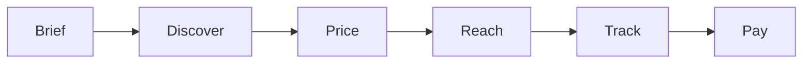
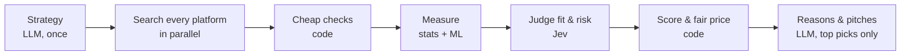

<div align="center">
  <br>
  <h1>Reach AI</h1>
  <p><strong>Creator marketing for founders without a marketing team.</strong><br>
  Find the creators who will convert for your product, know what to pay them, and reach them, from one brief.</p>
  <p>
    <a href="#-what-you-can-do">Features</a> ·
    <a href="#-pricing-and-roi">Pricing & ROI</a> ·
    <a href="#-proof">Proof</a> ·
    <a href="#-build-on-it">Build on it</a> ·
    <a href="https://reach-ai-influencer-marketing.vercel.app/docs">Docs</a> ·
    <a href="https://reach-ai-influencer-marketing.vercel.app/demo">Live demo</a>
  </p>
</div>

| ⏱ **10–30 s** per search | 💸 **< 1¢** AI cost per search | 🎯 **0** size/country limits broken in blind tests | ⚡ **7.7 → 0.6 s** cold load |
|:-:|:-:|:-:|:-:|

## ◈ The problem

Creators sell to founders' customers better than ads do, but for a founder doing it alone:

- **Finding the right creators takes days** of scrolling, and follower counts say nothing about whether *your* buyers watch them.
- **Nobody knows a fair price.** One sponsored post costs **$200–2,000**; overpaying, or paying the wrong creator, burns the budget.
- **The tools are built for marketing teams.** Creator databases cost **$199–600 a month**, often yearly, and still leave the founder doing the work.

**Reach AI** turns one brief into a ranked shortlist of creators who fit, a fair price for each, and a personal pitch for each, in under a minute.

## ◈ What you can do



| | |
|---|---|
| **Discover** | Creators ranked by how well their real content and audience fit your product, not by followers. YouTube, X and LinkedIn for B2B/AI founders; Instagram and YouTube for consumer apps. Rising creators and creators who already promoted a competitor are surfaced first. |
| **Price** | Median views, reliability, engagement vs creators of the same size, fake-engagement detection, expected clicks, and a **fair price range** per post. |
| **Reach** | One personal pitch per creator (email, Instagram, X, LinkedIn), every claim checked against their real content. The creator's verified business email. Sent from your own inbox, with follow-ups that stop when they reply. |
| **Track** | Drafts and approvals on a creator page; automatic checks that the post went live with your link, code and #ad; views, clicks and signups vs the forecast. |
| **Pay** | Pay once the post is verified. A budget planner picks the creators with the most expected clicks per dollar. |

What's live today and what's next: **[roadmap](docs/ROADMAP.md)** · **[changelog](https://reach-ai-influencer-marketing.vercel.app/docs/changelog)**.

## ◈ Pricing and ROI

| Plan | Price | Credits / month | YouTube searches | Inboxes |
|---|---|---|---|---|
| Free | $0 | 15 (once) | 5 | — |
| Starter | **$49** | 120 | 40 | 1 |
| Growth | **$129** | 350 | 116 | 3 |
| Agency | **$349** | 1,000 | 333 | 10 |

Credits roll over (up to 2×). A YouTube search is 3 credits, X 10, Instagram 12, LinkedIn 20; **writing pitches is free**. You see a search's cost before it runs.

**Why it pays for itself** (illustrative): a creator quotes **$800**; their real views put the fair range at **$450–600**; you pay ~$600, **~$200 saved on one deal, 4× the Starter plan.** Every creator also shows expected clicks, so you compare **clicks per dollar** before you commit.

| | Creator databases (Modash, Upfluence) | Reach AI |
|---|---|---|
| Price | $199–600 / month, often yearly | **from $49 / month**, monthly |
| Built for | Marketing teams | **Founders** |
| From one brief you get | A database to search yourself | **A ranked shortlist, fair prices, personal pitches** |

## ◈ Proof

Every number below is measured; method and raw data are linked.

| What | Before | Now | How we know |
|---|---|---|---|
| AI cost per search | ~$5 (v1) | **< 1¢** | Every paid call logs a `cost_events` row |
| Search time | 4+ min (v1) | **10–30 s** | Live runs |
| First load after idle (production) | 7.7 s | **0.6 s** | Timed against the live app |
| Campaign list, p50 / 10 users at once | 151 / 742 ms | **37 / 153 ms** | [Benchmark](backend/scripts/bench/), [raw results](docs/benchmarks/2026-11-04-read-endpoints/) |
| Size & country limits broken (3 briefs, blind-rated) | 5 (old engine) | **0** | Blind 1–5 ratings; the rater didn't know the engine |
| Pitch quality | — | **28-case eval suite** | [`OUTREACH_EVALUATION.md`](backend/OUTREACH_EVALUATION.md) |
| Regressions caught | — | **233 tests**, no live API calls | `pytest`, on SQLite and real Postgres |

How the speed-ups were found: `EXPLAIN ANALYZE` showed full-table scans (3.6 → 0.14 ms with indexes); a counter showed a new DB connection on every status call (now 0); the campaign list read 2.9 MB of JSON to count leads (now counted in Postgres); heavy AI libraries loaded on every cold start (now only when a run starts: 1.45 → 0.86 s). Tests also caught a crash on empty results before release.

## ◈ How it works

**Cheap work first, expensive work last.** Each step narrows the list before a costlier one runs.



- **Numbers live in code** (views, engagement, fair price). **Judgments go to [Jev](https://docs.typesafe.ai/introduction)** (fit, safety, real person: fast, cheap, real probabilities). **LLMs only write** what people read.
- Runs are **durable**: a crash or timeout resumes from the last finished step (LangGraph checkpoints + Inngest).
- Nothing a model says can send a message or a payment on its own.

Full design: [`docs/TECHNICAL_SPEC.md`](docs/TECHNICAL_SPEC.md).

## ◈ Build on it

`Next.js` · `FastAPI` · `LangGraph` · `Inngest` · `PostgreSQL + pgvector` · `Jev` · `Gemini / gpt-oss` · `Clerk` · `Vercel`

```bash
# backend
cd backend && python -m venv .venv && source .venv/bin/activate
pip install -r requirements-dev.txt && cp .env.example .env   # add your keys
make dev                                                       # migrations, API, Inngest dev server
pytest tests -q                                                # no live API calls

# frontend
cd frontend && npm install && npm run dev
```

| Start here | |
|---|---|
| [`CLAUDE.md`](CLAUDE.md) | Rules for anyone (or any agent) changing the code |
| [`docs/ROADMAP.md`](docs/ROADMAP.md) | Every feature, its status, its spec and its files |
| [`docs/TECHNICAL_SPEC.md`](docs/TECHNICAL_SPEC.md) | The full design and the decisions behind it |
| [`backend/.env.example`](backend/.env.example) | Every environment variable, with what it's for |

<br>
<div align="center"><sub>Built by <a href="https://github.com/Srijan76-code">Srijan Patel</a></sub></div>
