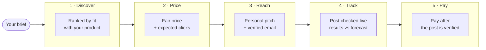
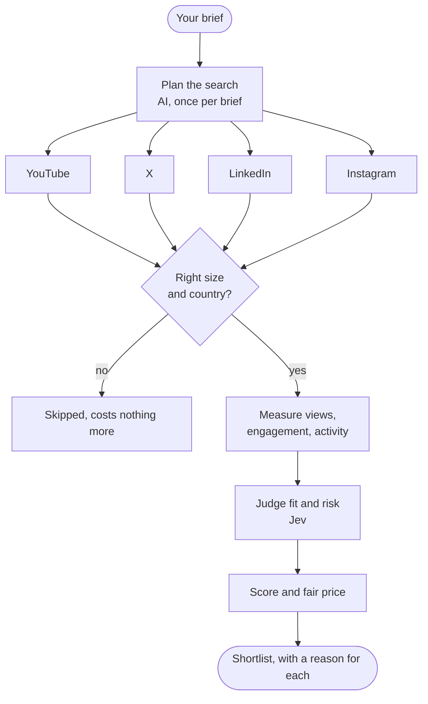
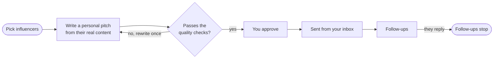
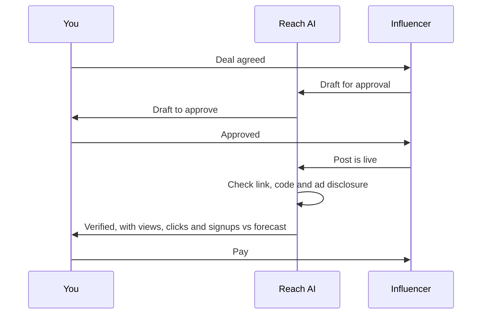
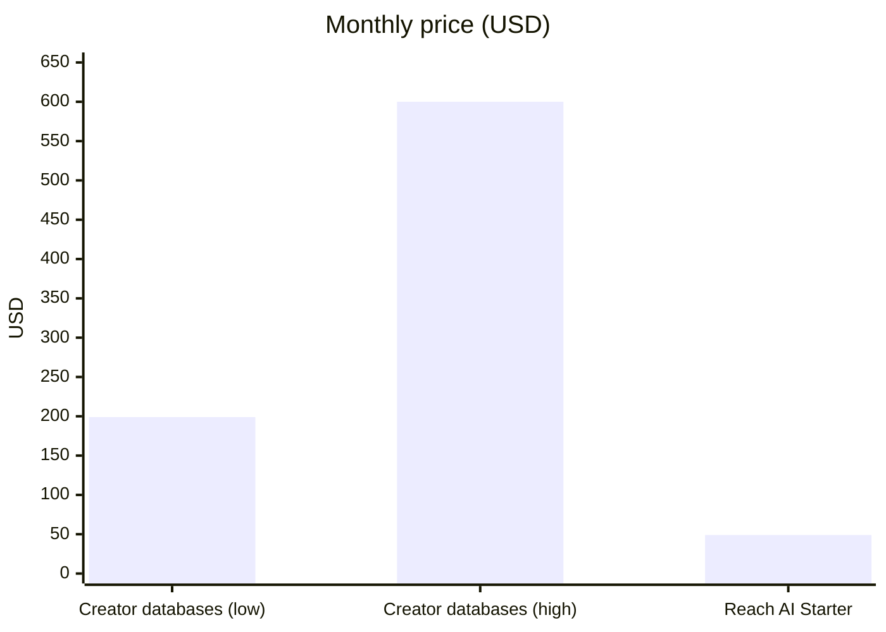
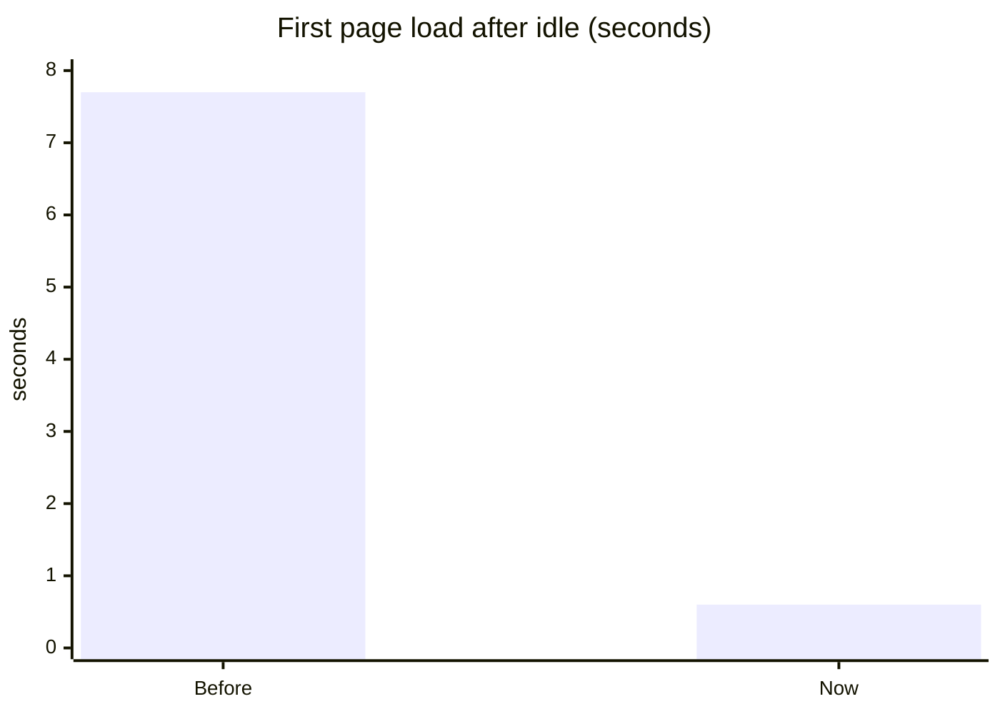

<div align="center">
  <br>
  <h1>Reach AI</h1>
  <p><strong>Influencer marketing for founders without a marketing team.</strong><br>
  Find the influencers who will sell your product, know what to pay them, and reach them, from one brief.</p>
  <p>
    <a href="#-what-you-can-do">Features</a> ·
    <a href="#-how-it-works">How it works</a> ·
    <a href="#-pricing-and-roi">Pricing</a> ·
    <a href="#-proof">Proof</a> ·
    <a href="#-build-on-it">Build on it</a> ·
    <a href="https://reach-ai-influencer-marketing.vercel.app/docs">Docs</a> ·
    <a href="https://reach-ai-influencer-marketing.vercel.app/demo">Live demo</a>
  </p>
</div>

<table align="center">
  <tr>
    <td align="center" width="25%"><br><b>&lt; 30 seconds</b><br><sub>to a ranked shortlist</sub></td>
    <td align="center" width="25%"><br><b>Fair price</b><br><sub>for every influencer</sub></td>
    <td align="center" width="25%"><br><b>$0 pitches</b><br><sub>personal, checked, unlimited</sub></td>
    <td align="center" width="25%"><br><b>From $49/month</b><br><sub>vs $199–600 for databases</sub></td>
  </tr>
</table>

## ◈ The problem

- **Finding the right influencers takes days**, and follower counts don't tell you if *your* buyers watch them.
- **Nobody knows a fair price.** One sponsored post costs **$200–2,000**.
- **The tools are built for marketing teams**: **$199–600 a month**, often yearly, and you still do the work.

**Reach AI** turns one brief into the influencers who fit, a fair price for each, and a message for each.

## ◈ What you can do



| | You get | In numbers |
|---|---|---|
|  **Discover** | Influencers ranked by how well their content fits **your** product, not by followers | **< 30 s** · YouTube, X, LinkedIn, Instagram |
|  **Price** | A fair price range, typical views, engagement and expected clicks | Every influencer |
|  **Reach** | One personal message each, sent from your own inbox, follow-ups that stop on reply | **$0** to write |
|  **Track** | Post goes live with your link, code and #ad; views, clicks, signups vs forecast | Automatic |
|  **Pay** | Payment only once the post is verified; a planner for the most clicks per dollar | After proof |

What's live today: **[roadmap](docs/ROADMAP.md)** · **[changelog](https://reach-ai-influencer-marketing.vercel.app/docs/changelog)**.

## ◈ How it works

**Finding influencers.** Cheap checks run first; AI only writes for the influencers you'll contact.



**Reaching out.**



**After the deal.**



## ◈ Pricing and ROI

| Plan | Price | YouTube searches / month | Inboxes |
|---|---|---|---|
| Free | $0 | 5 (once) | — |
| Starter | **$49** | 40 | 1 |
| Growth | **$129** | 116 | 3 |
| Agency | **$349** | 333 | 10 |

Credits roll over. X, Instagram and LinkedIn searches cost more credits because their data costs more. **Writing pitches is always free.**



**One deal pays for the plan** (illustrative): an influencer quotes **$800**, Reach AI shows a fair range of **$450–600**, you pay ~**$600**: **~$200 saved, 4× the Starter price.**

## ◈ Proof

Every number is measured. Method and raw data are linked.

| | Before | Now |
|---|---|---|
| AI cost per search | ~$5.00 | **< $0.01** |
| Time to a shortlist | 4+ minutes | **10–30 seconds** |
| First page load after idle | 7.7 s | **0.6 s** |
| Campaign list with 10 users at once | 742 ms | **153 ms** |
| Size or country limits broken (3 briefs, blind-rated) | 5 | **0** |
| Automated tests (no live API calls) | — | **233** |



How: costs are logged on every paid call; speed was found with `EXPLAIN ANALYZE` and connection counters, then re-measured with the same [benchmark](backend/scripts/bench/) ([raw results](docs/benchmarks/2026-11-04-read-endpoints/)); quality was rated blind. Pitch quality has a 28-case [eval suite](backend/OUTREACH_EVALUATION.md).

## ◈ Build on it

`Next.js` · `FastAPI` · `LangGraph` · `Inngest` · `PostgreSQL + pgvector` · `Jev` · `Gemini / gpt-oss` · `Clerk` · `Vercel`

```bash
cd backend && python -m venv .venv && source .venv/bin/activate
pip install -r requirements-dev.txt && cp .env.example .env   # add your keys
make dev                                                       # migrations, API, Inngest
pytest tests -q                                                # no live API calls

cd frontend && npm install && npm run dev
```

| Start here | |
|---|---|
| [`CLAUDE.md`](CLAUDE.md) | Rules for changing the code |
| [`docs/ROADMAP.md`](docs/ROADMAP.md) | Every feature, its status and files |
| [`docs/TECHNICAL_SPEC.md`](docs/TECHNICAL_SPEC.md) | The full design and decisions |

<br>
<div align="center"><sub>Built by <a href="https://github.com/Srijan76-code">Srijan Patel</a></sub></div>
