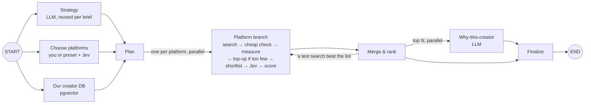
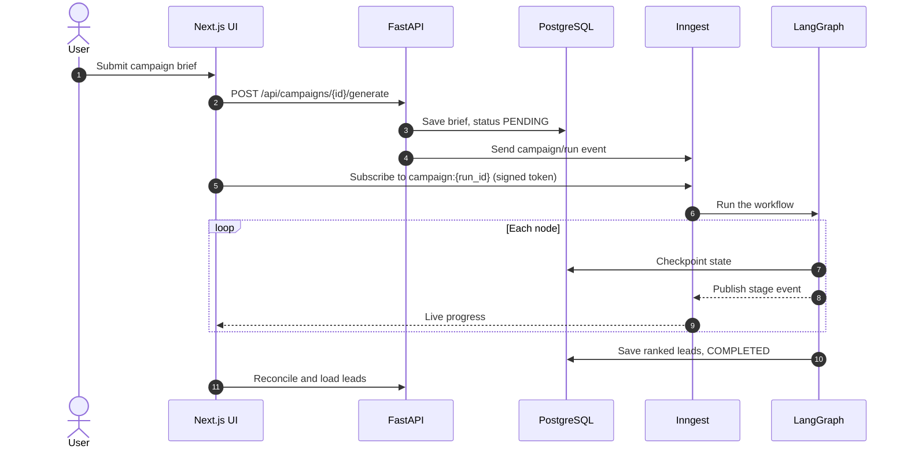

<div align="center">
  <br>
  <h1>Reach AI</h1>
  <p><strong>Creator marketing that startup and solo founders can actually run</strong></p>
  <p>Find the creators who will convert for your product, see what each one should cost, reach them, and track what they deliver, all in one app.</p>
  <br>
  <a href="#-why-reach-ai">Why</a> ✦
  <a href="#-what-it-does-today">What it does</a> ✦
  <a href="#-how-we-improved-it">How we improved it</a> ✦
  <a href="#-where-its-going">Where it's going</a> ✦
  <a href="#-why-jev">Why Jev</a> ✦
  <a href="#-architecture">Architecture</a> ✦
  <a href="#-getting-started">Getting started</a>
  <br>
</div>

<hr>

## ◈ Why Reach AI

I built Reach AI after seeing how hard creator discovery was while building **Haven**, a college dating app. Our first organic campaign reached 17k+ views in a week, but finding the right creators still meant hours of manual scrolling and guesswork, with no idea what a fair price was.

Founders have the same problem everywhere:
- **No marketing team, small budgets.** Solo founders spend roughly $60–180 a month on all their software, and one sponsored post costs $200–2,000.
- **Existing tools aren't built for them.** Database tools (Modash, Upfluence) cost $199–600 a month, often on annual contracts, and still leave the founder doing the work.
- **The two biggest fears are wasted time and overpaying.** Founders don't know which creators will convert, or what a creator should cost.

**Positioning:** *the creators who will actually convert for you, and what you should pay them.* We compete on match quality and fair pricing, not on being the cheapest.

<br>

## ◈ What it does today

| Feature | Status |
|---|---|
| **Discovery engine** (LangGraph): strategy from the brief, platforms searched in parallel, cheap checks before anything paid, Jev judges fit and risk, numbers scored in code, reasons written only for the creators you'll contact | ✅ Live |
| **Fair price and performance**: median views, reliability, engagement vs creators of the same size, fake-engagement detection, expected clicks, fair price range | ✅ Live |
| **Badges**: Rising, On trend, Check engagement, Country unknown; live "scored so far" count while a search runs | ✅ Live |
| **Platform choice** in the brief (or let ReachAI choose); YouTube today | ✅ Live |
| **Durable runs**: a crashed or timed-out run resumes from its last finished step (LangGraph checkpoints + Inngest retries); re-running cancels the old run | ✅ Live |
| **Personalised pitches** per creator (email, Instagram, X, LinkedIn), rule-validated with one automatic repair, cost-logged | ✅ Live |
| **YouTube 30-day data policy**: nightly refresh of useful creators, everything else deleted after 30 days | ✅ Live |
| Export to Instantly / Smartlead · user docs and changelog at `/docs` | ✅ Live |
| X (twitterapi.io), Instagram, LinkedIn · in-app sending and follow-ups · post tracking · billing | 🛠 Planned (see [roadmap](docs/ROADMAP.md)) |

<br>

## ◈ How we improved it

### v1 → v2: from $5 to $0.04 per run
The first working version cost about **$5 per run** and took **4+ minutes**. Tracing every step in LangSmith showed where the time and money went, so I:
- moved expensive work to **concurrent, batched** processing (enrichment 20 channels at a time, LLM reranking in batches of 15);
- put **cheap filters first** (subscriber, country, activity and engagement checks in code) so the LLM only sees a shortlist;
- added a **hybrid semantic filter** (embeddings + BM25) that keeps the top 30 before any LLM call;
- **cached** repeated work and removed unnecessary sequential model calls;
- wrote the "why this creator" reasoning **only for the creators the user actually gets**.

| Metric | v1 | v2 |
|---|---|---|
| AI cost per run | ~$5 | **~$0.04** (−99%) |
| Run time | 4+ min | **1–2 min** (−60%+) |
| Quality | — | Beat Aha (market leader) and v1 on the same brief, then held up across other briefs, including edtech |

### Outreach: tested, not guessed
Pitch generation runs one branch per creator. A **rule validator** catches AI clichés, leaked internal scores, wrong channels and too many questions, and repairs a pitch at most once. A **LangSmith eval suite** (28 cases from real leads) scores groundedness, personalisation, tone and CTA quality, so prompt changes are measured before they ship. See [`backend/OUTREACH_EVALUATION.md`](backend/OUTREACH_EVALUATION.md).

### v2 → v3: new discovery engine, compared blind
Before switching, the old and new engines ran on the same 3 briefs (fitness app in India, invoicing SaaS in the US, API monitoring in the UK/US). A separate model then rated every creator 1–5 **without knowing which engine found it**.

| Brief | New engine | Old engine |
|---|---|---|
| Fitness app (India) | 3.4 avg, 5 good, no rule broken | 3.2 avg, 5 good, 1 over the size limit |
| Invoicing SaaS (US) | 2.4 avg, 2 good | 2.5 avg, 2 good, 3 over the size limit |
| API monitoring (UK/US) | 1 lead (too few found) | 2.8 avg, 3 good, 1 over the size limit |

The new engine never broke the size or country limits; the old one did 5 times. Its weakness was finding enough creators for niche B2B products, which led to the fixes now in place: short search phrases, rank fusion across searches, and a cheap size check for every candidate. The score labels were also recalibrated on 63 scored creators: before, no creator could reach "Strong Buy". Raw data and the method are in the roadmap (K13, K14).

### Backend speed: measured, then fixed
Campaign pages felt slow. Instead of guessing, every claim below was measured; where something was simulated, it says so.

**1. Production cold start (the main cause).** Timed against the live app (a request with no login returns 401 before any database work, so it measures pure start-up):

| | First request after idle | Warm requests |
|---|---|---|
| Before | **7.7 s** | 0.25–0.33 s |
| After | **0.6 s** | 0.18–0.31 s |

Fixes: heavy libraries (LangGraph, the outreach graph) now load only when a run starts, cutting app start-up from **1,453 → 863 ms** (median of 7 fresh processes); Fluid compute is on; a 5-minute Inngest keep-warm call keeps one instance loaded without touching the database, so Neon can still sleep.

**2. Read endpoints.** A [seeded database](backend/scripts/bench/seed.py) with production-shaped data (6,010 campaigns, 18,000 saved leads, 300 users) and the real FastAPI app; a proxy adds a simulated 2 ms each way to every database round trip. Medians of 3 runs, same script for both versions ([raw results](docs/benchmarks/2026-11-04-read-endpoints/)):

| Endpoint | p50 | p95, 10 at once | Requests/s | Extra DB connections |
|---|---|---|---|---|
| Campaign list | 151.5 → **37.1 ms** | 742 → **153 ms** | 20 → **106** | 0 → 0 |
| Campaign leads | 40.0 → **35.0 ms** | 186 → **112 ms** | 87 → **157** | 0 → 0 |
| Run status | 53.0 → **31.5 ms** | 150 → **107 ms** | 94 → **160** | **1 → 0** per call |
| Saved leads | 46.6 → **37.4 ms** | 144 → **73 ms** | 109 → **153** | 0 → 0 |
| Details | 35.5 → 31.3 ms | 119 → 114 ms | 141 → 160 | 0 → 0 |

What was wrong, found with `EXPLAIN ANALYZE` and query/connection counters:
- The campaign list loaded **every campaign's full results JSON (2.9 MB for 30 campaigns) just to count leads**. Now Postgres counts them and only the shown columns are read.
- **No index** on `campaigns.user_id` or `saved_leads.campaign_id`: both were full-table scans over every user's rows (3.6 ms → **0.14 ms** and 7.7 ms → **0.06 ms** with the new indexes).
- `/status` opened a **brand-new database connection on every call** for a field the UI never used.
- The leads endpoint decoded 90 KB of JSON into Python and encoded it back; now the stored JSON is passed straight through (tests check the response is identical).

**3. Problems the testing caught.**
- 2 production campaigns store empty results as JSON `null`, which would have crashed the faster campaign-list query; caught by a test before release.
- Inngest had been **rejecting every app sync** since the new engine went in (it asked for 10 concurrent runs; the free plan allows 5), so scheduled jobs were never registered. Fixed, with a test that keeps every function within the plan.

Reproduce it:
```bash
cd backend
createdb reachai_bench && DATABASE_URL=postgresql+asyncpg://localhost/reachai_bench alembic upgrade head
python -m scripts.bench.seed postgresql+asyncpg://localhost/reachai_bench     # prints bench_campaign
python -m scripts.bench.bench --campaign <bench_campaign> --db postgresql://localhost/reachai_bench --delay-ms 2
```

<br>

## ◈ Where it's going

The discovery engine already follows the rule that made v2 cheap (**cheap work first, expensive work last**); the rest of the product applies it across the whole funnel. Full design: [`docs/TECHNICAL_SPEC.md`](docs/TECHNICAL_SPEC.md). Status of every feature: [`docs/ROADMAP.md`](docs/ROADMAP.md).

**1. Who does what.** Every step goes to the cheapest thing that can do it well:

```
Code / APIs  →  Statistics / ML  →  Jev (judgments)  →  Code (scoring)  →  LLM (writing)
   free             ~free              ~$0.01/run            free            top picks only
```

- **Numbers stay in code**: median views, growth momentum, engagement compared with creators of the same size, fake-engagement detection (Isolation Forest), fair price.
- **Judgments go to Jev**: is this a real person, does the content fit the product, is the audience right, is it brand-safe, is it for kids.
- **LLMs only write** what people read: the campaign strategy, the "why this creator" brief, pitches and replies.

**2. More platforms, chosen by founder type.**
- B2B and AI founders get **YouTube, X and LinkedIn**.
- Consumer-app founders get **Instagram and YouTube**.
- A quick Jev check adjusts this for each product, and the founder can switch any platform on or off.

**3. Cheapest sources first, without missing the best creators.**
- Each run checks, in order: our own creator database, YouTube, then the other accounts creators link from their own profiles.
- A **small test search on every selected platform** follows. If any creator from it would make the current top list, that platform gets a full search.
- A benchmark against full searches must find at least 90% of the same top 10.

**4. Outreach that founders can trust.** A founder contacts about 15–40 creators, so every message matters:
- the creator's own business email, verified, with sponsor and guest addresses filtered out;
- one research profile per creator, reused by every message;
- every claim in a pitch checked against the creator's real content;
- sent from the founder's own inbox, after approval;
- follow-ups that stop the moment the creator replies on any platform.

**5. After the deal.**
- A creator page to sign and submit drafts.
- Automatic checks that the post went live, with the link, promo code and #ad disclosure.
- Views, clicks and signups compared with our forecast.
- A pay-now request once the post is verified.
- A budget planner that picks the creators with the most expected clicks per dollar.

**6. Pricing.** A small monthly plan with credits that carry over (Starter $49, Growth $129, Agency $349). Payments go through Cashfree. Costlier platforms use more credits, and writing pitches is free.

<br>

## ◈ Why Jev

Most of the AI work in an influencer pipeline isn't writing. It's **judging**: *is this a real creator? does this audience match the persona? is this post sponsored? is this reply interested or declining?* Using an LLM for these is slow, expensive and hard to calibrate, because LLMs tend to hand out the same few scores (70, 85…) and their numbers aren't real probabilities.

[**Jev**](https://docs.typesafe.ai/introduction) by TypeSafe AI is a *System One* model built for exactly this. You send it some state and typed questions, and it returns typed answers with probabilities:

| Question type | Returns | Example in Reach AI |
|---|---|---|
| **Noul** (yes/no) | P(yes) | "Is this account a single person, not a brand or reupload page?" |
| **Choice** (one of a list) | option + confidence | "Main niche?", "Is this reply interested, asking for rates, or declining?" |
| **Score** (scale of situations) | level 0…n, can be fractional | "How closely do the recent posts match the product?" |

**Why it fits:**
- **Cost:** about **$0.042 per million input tokens**, and output is free. Judging 100 creators with ~10 questions each costs about **$0.006**.
- **Speed:** about 100 ms per request, and all of an item's questions run in parallel inside one request.
- **Calibrated numbers:** thresholds like "drop if P(individual) < 0.4" mean something, and the numbers can become features for a learned ranker later.
- **It doesn't write text**, so it can't invent claims. Writing stays with the LLM, on the shortlist only.

**Where Jev is used** (discovery today; the rest as those features ship):
- creator fit, audience, safety, kids content, language and niche;
- picking a platform;
- choosing the creator's real email from several candidates;
- checking every claim in a pitch;
- sorting replies;
- confirming a post promotes the product and has a disclosure.

**How we use it safely:**
- The model version is pinned (`jev-1.13.0` direct, `typesafe/jev-1.14-20261014` through OpenRouter), with at most 8 requests at a time.
- Score labels are calibrated on real scored creators against blind ratings (63 so far); full tuning on about 300 labelled creators is next.
- If Jev is unavailable, the same questions go to an LLM fallback and come back in the same shape.
- A Jev answer alone can never trigger a send or a payment.

<br>

## ◈ Architecture

### Discovery engine
A LangGraph graph run (and resumed) by Inngest. Steps that don't depend on each other run in parallel; every platform is its own branch.



### Run flow and live progress


### Durable runs
LangGraph saves a checkpoint after every step (Postgres). If a run crashes or times out, Inngest retries it and the retry **resumes from the last finished step** instead of starting over. Inngest also limits runs (2 per user, 5 at once), cancels the old run when a campaign is re-run, and runs the nightly YouTube refresh. Caches (searches, Jev answers, embeddings, strategy) live in Postgres so they survive across serverless calls. Details in spec §4.14.

<br>

## ◈ Tech stack

`Next.js` · `TypeScript` · `Python` · `FastAPI` · `LangGraph` · `Inngest` · `PostgreSQL` · `LangSmith` · `Jev (TypeSafe AI)` · `Gemini` / `gpt-oss-120b` (Groq, Cerebras) · `Clerk` · `Zustand` · `Vercel`

<br>

## ◈ Project structure

```text
ReachAi-InfluencerMarketing/
├── backend/
│   ├── app/
│   │   ├── api/routes/     Campaign, saved-lead and outreach routes
│   │   ├── discovery/      Discovery graph, runtime (run/resume), brief, prompts, limits
│   │   ├── platforms/      Platform adapters (YouTube today), one interface for all
│   │   ├── metrics/        Numbers in code: stats, anomaly detection, fair price
│   │   ├── judge/          Jev questions, client and scoring
│   │   ├── creators/       Creator database and the nightly YouTube refresh
│   │   ├── llm/            LLM routes with fallbacks; embeddings
│   │   ├── outreach/       Pitch generation graph (generate → validate → repair)
│   │   ├── inngest/        Background functions (runs, refresh, keep-warm)
│   │   └── models/         SQLAlchemy models (migrations in alembic/)
│   ├── scripts/bench/      Read-endpoint benchmark (seed + run)
│   └── tests/              Unit, graph, API and outreach tests (no live API calls)
├── frontend/               Next.js app (campaign flow, results, outreach)
│   └── content/docs/       Public user docs (served at /docs)
├── docs/
│   ├── ROADMAP.md          What's built, what's next, where each spec is
│   ├── TECHNICAL_SPEC.md   Full design and decisions
│   └── benchmarks/         Raw benchmark results
└── CLAUDE.md               Guide for coding agents working on this repo
```

<br>

## ◈ Getting started

**Prerequisites:** Python 3.11+, Node.js 20+, PostgreSQL, a Google Cloud project with YouTube Data API v3, and a Google AI Studio key.

```bash
# Backend
cd backend
python -m venv .venv && source .venv/bin/activate
pip install -r requirements.txt
cp .env.example .env            # then fill in the keys below
alembic upgrade head
uvicorn app.main:app --reload
```

```bash
# Inngest dev server (second terminal)
cd backend
npx inngest-cli@latest dev -u http://localhost:8000/api/inngest
```

```bash
# Frontend (third terminal)
cd frontend
npm install
npm run dev
```

```bash
# Tests (no live API calls)
cd backend
pip install -r requirements-dev.txt
pytest tests -q
# Also on real Postgres + pgvector (a THROWAWAY database: it is wiped)
PG_TEST_URL=postgresql+asyncpg://localhost/reachai_unit pytest tests -q
```

### Environment variables (`backend/.env`)
| Variable | What it's for | Required |
|---|---|---|
| `DATABASE_URL` | PostgreSQL (`postgresql+asyncpg://…`) | ✅ |
| `GOOGLE_API_KEY` | Gemini models | ✅ |
| `YOUTUBE_API_KEY` | YouTube Data API v3 | ✅ |
| `INNGEST_DEV` | `1` for local development | Local |
| `INNGEST_EVENT_KEY`, `INNGEST_SIGNING_KEY` | Inngest Cloud | Production |
| `CLERK_JWKS_URL` | Clerk auth | Production |
| `TYPESAFE_API_KEY` | Jev (TypeSafe key or an OpenRouter key) | ✅ |
| `GROQ_API_KEY` | gpt-oss-120b, backup writing model | Recommended |
| `CEREBRAS_API_KEY` | Second backup model | Optional |
| `LLM_BACKEND`, `LANGSMITH_GATEWAY_URL` | Use the LangSmith LLM Gateway instead of direct calls | Optional |
| `X_PROVIDER_API_KEY` | twitterapi.io, for X discovery | Later |

> [!IMPORTANT]
> The YouTube Data API allows **10,000 units a day**. Each search costs ~100 units, so one run uses about 1,000 units: roughly 10 runs a day. Searches are cached for 24–72 hours and the quota resets at midnight Pacific time.

<br>

---

<div align="center">
  <i>Built by <a href="https://github.com/Srijan76-code">Srijan Patel</a></i>
</div>
